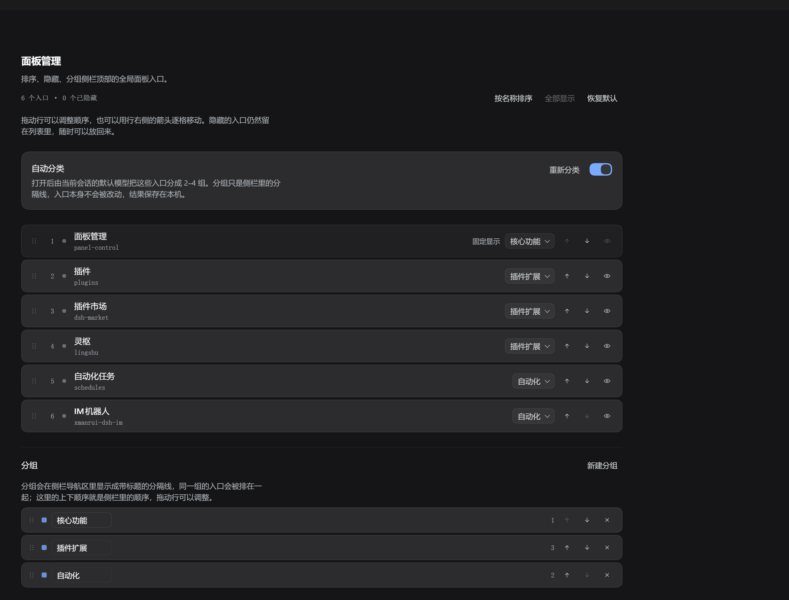
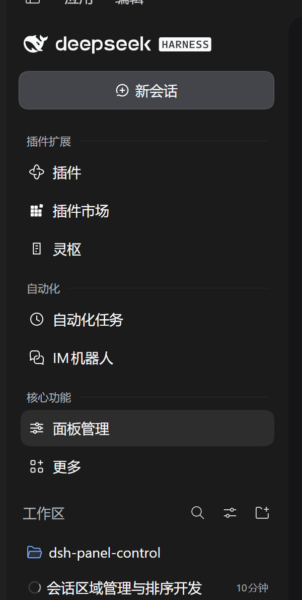

# dsh-panel-control · 侧栏面板管理

管理 **DeepSeek Harness 侧栏顶部、新会话按钮下方、工作区上方** 的那一列入口（插件 / 插件市场 / 自动化任务 / IM 机器人 / 灵枢 / 工作区管理 …）。

这块区域在实现里叫 **全局面板导航区**，由 `@deepseek-ai/dsh-client-ui-sidebar` 渲染 `sidebar.panellist` 这个列表槽：每个插件把自己的面板注册成槽里的一个 entry，「更多」是由 `sidebar.panellist.actions` 撑起来的溢出菜单。顺序只由注册时的 `order` 决定，宿主没有提供任何运行时接口去改别人的 `order`，所以本插件用一层 DOM 适配器（CSS `order` + `display` + 分组分隔线）实现，不侵入宿主代码。

## 功能

- **排序**：拖动行首的把手把任意一行放到任意位置；「按名称排序」一键 A→Z；「恢复默认」回到插件注册时的原始顺序。
- **隐藏**：每行右侧的眼睛图标。隐藏项只是不显示，仍留在列表里，随时可以放回来（也可以在「更多」菜单里临时恢复）。隐藏不会写任何插件配置，也不会影响该插件本身是否加载。
- **分组**：新建分组（如「创作」「系统」）并给入口分配分组后，侧栏导航区会在组与组之间插入一条**带标题的分隔线**，同组入口自动排在一起。**组的先后顺序完全由设置里的分组列表决定**——分组区和入口列表一样用行首把手拖动排序，拖完就是侧栏里的顺序，不随入口的注册顺序或分类结果漂移。侧栏折叠成图标条时自动不显示标题、不插分隔线。
- 插件自己的「面板管理」行固定显示，不可隐藏（防止把自己锁在门外）；未接管的节点（如「更多」）始终排在最后。
- **自动分类**：打开「自动分类」开关后，本插件会让当前 profile 的默认模型读一遍入口名称，把它们分成 2–4 组并写好分组名（如「插件扩展」「自动化」「核心功能」）。它**只处理自己还没见过的入口**：装上一个新插件时补一次分类，其余时候不会重跑，也不会改动你已经排好的顺序；想整体重来就手动点「重新分类」。开关只影响分组，不动排序/隐藏；分类结果同样只是本机偏好，不会写进任何插件配置。
- **布局存在 Host 的配置目录里**：`~/.dsh/panel-control/prefs.json`（`~` 是这个 profile 的用户目录）。渲染层的 origin 是 Host 的 loopback 端口，每次启动都会换端口，`localStorage` 会因此"看起来每次都清空"——所以真正的存储放在 Host 侧，`localStorage` 只留一份镜像，读不到 Host 时才回退。按安装维度生效，不跟随工作区。

入口有两处：侧栏导航里的「面板管理」行（滑块图标），以及 **设置 → 面板管理**——后者不是一句「去打开面板管理」的提示，而是把同一套管理界面整块嵌进设置页：排序、隐藏、分组、自动分类都在里面直接可用。



侧栏里分组后的效果（模型自动分类出的 `插件扩展` / `自动化` / `核心功能`）：



## 界面

页面按 DSH 插件的页面框架摆：滚动条在页面层、边距落在内容列上，正文列上限 960px 居中，`28px + --dsh-frame-top-clearance` 起头。颜色全部取自 `--dsw-*` 语义 token（深浅色主题共用一套规则，不写死颜色、不分支 `prefers-color-scheme`），层级靠表面台阶 + 发丝线而不是阴影。字号收敛成 11/12/13/16 四档，数字与 id 用等宽体 + `tabular-nums`。行一律单行：名称与注册 id 同行、行高 40，页头压成「标题 + 操作 / 副标题 · 计数 / 一行提示」三行，分组名输入框按内容收窄而不是拉成一条长框。图标统一 16px、描边 1.5 的自绘 SVG（没有 emoji，也没有借用字体里的箭头字符）。控件圆角 6–10，卡片 12，动效只有一个 `cubic-bezier(.16,1,.3,1)` 的 120ms 反馈与一次 180ms 入场，系统开启"减少动态效果"时全部关闭。

视觉规范沿用 [unslop](https://github.com/heydamir/unslop)（Damir Sokolovsky，CC BY 4.0）的思路，按 DSH 的 token 体系与页面框架改写；分组下拉是自绘的，因为原生 `<select>` 的选项列表由系统控件绘制，深色主题下会弹出白底白字。

把这套页面做出来时踩到的具体数字与坑（页面框架、单行行高、输入框居中、两套列表的统一重排、热替换时的样式表打架、无 DevTools 的现场验证）整理在 [docs/ui-design-notes.md](docs/ui-design-notes.md)。

## 安装

```bash
# 1. 放进全局 profile（本地开发用 link:）
#    C:/Users/<you>/.dsh/profiles/desktop/package.json
#    "dsh": { "profile": { "bundles": [ ..., "dsh-panel-control" ] } }
#    "dependencies": { ..., "dsh-panel-control": "link:D:/Github/dsh-panel-control" }
#
# 2. 建目录链接（免管理员）
cd C:/Users/<you>/.dsh/profiles/desktop
cmd //c mklink /J node_modules\\dsh-panel-control D:\\Github\\dsh-panel-control
```

装好后**不需要重启 DSH**：新增 bundle 会随下一次页面重载生效（`Ctrl+R`，或界面里的刷新）。

## 实现要点

- 两半：`client.js` 管布局（排序 / 隐藏 / 分组分隔线），`index.js`（Host）只做一件事——提供「让模型分类」的唯一一条路由。
- 客户端拿不到模型：`ctx.remote.llm.*` 只有 `listProviders` / `listConfigurableProviders` / `discoverModels` 三个只读方法，没有任何补全入口，所以模型调用必须落在 Host 侧。
- Host 路由：`ctx.connection.fetch.register({ path: '/api/dsh-panel-control/classify', methods: ['POST'], requestBody: 'buffered' })`，信封与 `/api` 网关一致（`{type:'client-request', rpcId, method, payload}` → `{type:'server-response', rpcId, result}`）；只接受 loopback 的 Host/Origin、只接受 `application/json`、请求体上限 64 KB、45 s 超时，一次请求最多 1 次模型调用。
- 模型调用：`ctx.agentDefaultModel.currentSelection()` 取默认 provider/model，`ctx.llm.prepareCall(...)` 后 `prepared.stream(prepared.config)` 收流并拼 `text-delta`。分类不需要思考预算，因此该次调用固定 `reasoningEffort: 'off'`（否则思考会吃掉输出额度、拿不到正文）；返回的 JSON 在 Host 侧就做白名单清洗（未知 id、重复 id、超过 4 组、超长组名都会被丢弃）。
- 设置读写也走同一条路由：`{method:'load'}` / `{method:'save'}`（原子写 `prefs.json`，上限 256 KB），另有 `{method:'report'}` 把客户端的异常与启动信息写进 `~/.dsh/panel-control/client.log`。Host 侧日志写在同目录的 `host.log`，出问题先看这两个文件。
- 干净降级：`connection` 或 `llm` 不可用时路由不注册 / 返回明确错误，客户端在开关下方显示原因，不影响布局功能。
- 启动稳定性（v0.3.0 修的三个真问题）：①`apply()` 里调用的 `applyInner` 曾是对象方法——方法名不在词法作用域里，`apply()` 直接 `ReferenceError`，于是"插件装了但没运行"，现已改成真正的函数；②`locale` 不再是硬依赖，`inject` 只留 `slots`，可选服务统一走 `optionalService(ctx, name)`（`ctx.get(name)` + `try`），缺服务只会降级不会让 `apply` 抛错；③宿主渲染侧栏可能晚于插件 apply，引擎启动改成 `[0,120,400,1000,2500,5000,9000,14000] ms` 重试 + 每 3 s 轮询直到找到导航区容器。
- 定位导航区：优先 `[class*="panelList"]`，失败时用已知面板的 `button[aria-label]` 反查公共父节点。
- 行身份：以 `sidebar.panellist` 的 `entriesOfSlot()` 顺序（按 `order` 稳定排序）为位置主键，用 DOM 的 `aria-label` 做二次校验，宿主重渲染后自动重新对齐。
- 应用方式只写 `style.order` / `style.display` / `data-dpc-group`，不移动 DOM 节点，避免与 React 的 reconciliation 打架。
- 变更来源：`MutationObserver`（childList + class/style 属性）、`window.resize`、`ctx.slots.subscribe('sidebar.panellist')`、`ctx.locale.subscribe` 都汇入一次 `requestAnimationFrame` 去抖的 `schedule()`；应用期间暂停 observer 防止自激，签名不变时短路。
- 语言：注册 `locale` 命名空间 `dsh-panel-control`，中英双语，跟随界面语言切换。

## 自测

`.scratch/harness.html` 是引擎测试页：伪造 `panelList` DOM、假 `react`、假 `ctx`，直接驱动 `testables.createEngine()`，覆盖排序 / 隐藏 / 分组分隔线 / 分组顺序不漂移 / 两套列表共用的拖拽重排规则 / 折叠态 / 新注册项 / 脏数据清洗，当前 **27 项全部通过**。`.scratch/apply-test.html` 另外用伪 Cordis 上下文调用真实的 `apply(ctx)`，断言它注册了 `locale` / `main` / `settings.section` / `sidebar.panellist` 四样东西——上一版的 `ReferenceError` 就是它抓出来的。

```bash
python -m http.server 8787 --bind 127.0.0.1   # 在仓库根目录
# 打开 http://127.0.0.1:8787/.scratch/harness.html
```

## 重启后「插件不见了」怎么办

桌面端窗口加载插件时用的是**应用启动那一刻冻结的一份插件清单**。如果在这份清单生成之后又改过插件代码（开发时改一次 `client.js` 就算），新开的页面仍会按清单里的旧版本号去要脚本，Host 现在服务的是新版本，那次请求就答 404 —— 结果就是**这个插件静默地没有加载**，屏幕上什么都不说，看起来像「重启后插件不会自己运行」。手动刷新一次页面（桌面端右上角的刷新按钮，或 `Ctrl+R`）就会按当前清单重新加载。

### 那条「清单过期」的提示什么时候才算数

提示条只在**真有入口没加载**时出现：拿 Host 当前清单里的 id 和这个页面启动时拿到的 id 逐一对，缺了才说。早先它还比较两边清单的版本号，于是每次改插件文件（版本号必然变）都会弹一次「刷新一次即可同步」——页面其实什么都不缺，提示却赶不走，还叠一句「刷新后仍然缺」。现在版本号只写进「诊断」里给人看，不参与判断。

另外两处防呆：刷新提示只在**这次页面自己发起的刷新**之后 10 分钟内、且缺的还是同一批 id 时才追加「关一次再打开」；提示条右侧有一个 ✕，点掉后对同一批 id 不再出现（只作用于当前页面）。

### 插件自己把自己救回来

等用户去点刷新不够可靠：桌面端没有绑定 `Ctrl+R`，一些版本的刷新按钮也会被其它插件按住。所以 Host 半启动 12 秒后如果还没等到 Client 半的上报，就做一次**恢复推动**（recovery nudge）：

1. 翻转 `client.js` 末尾的换行（有就删、没有就加，字节级可逆，文件不会越长越大）；
2. 这个包的文件被加载器盯着，一次内容变化就足以让它在**已经打开的页面里**热加载这个插件；
3. 面板随即出现，`host.log` 留一行 `recovery nudge: rewrote client.js …`，Client 半也不会再为「缺的其实是我自己」弹提示条。

代价只有一条：`client.js` 最后一个字节会在两次启动之间来回变，`git status` 偶尔会看到一次无意义的尾随换行改动。不想让它碰文件就设 `DPC_NUDGE=off`，此时 Host 只记一行日志、不写盘。

本插件为此做了两件事：

- Host 半每次挂载路由后起一个 20 秒的看门狗；如果这段时间里客户端半一次都没有上报 `boot`，就往 `~/.dsh/panel-control/host.log` 写一行明确的结论（`client half did not report within 20s: ...`），不再让日志沉默。
- 建议同时保留 **dsh-unlag**（就是桌面端那个刷新按钮的插件）：它会把「按旧版本号要脚本」的请求答成当前版本的内容，页面就不会因为版本号对不上而少插件；真的缺插件时它也会在界面上说一句。

排查顺序：`~/.dsh/panel-control/host.log` 看 Host 有没有挂上路由 → `client.log` 看有没有 `boot` → 两条都有但侧栏没入口，就按一次刷新按钮。

## 提示条只该出现一次（0.3.12）

「这个页面用的插件清单，已经不是最新的了」这条提示会因为一个更麻烦的原因反复出现：
应用给每个页面的是**它启动时冻结的那份清单**，所以安装完新插件后**刷新页面并不改变清单**——
页面照样拿不到那个插件，提示条也就照样出现。之前它每次加载都弹，还把"刷一次就好"当结论，
等于把用户往一个不会成功的操作上引。

现在：

- 同一组缺失**只提示一次**（记在 `localStorage` 的 `dsh.panel-control.notice-nagged`），
  刷新后还在就保持安静，诊断里仍能看到 `本页缺失` / `已提示过`。
- 文案改成「刷新后仍然缺：重启 DSH 才会应用新的插件清单」——这才是真正有效的动作。
- 缺口修复后自动清除记忆，下次真出现新缺口还会提示。

## 代码审查后的加固（0.3.11）

一轮完整审查（正确性 / 安全 / 可维护性 / 性能）之后改掉的东西，按主题记在这里，免得以后又踩回去。

**安全**

- 路由只认自己这一页：以前只校验「Host 和 Origin 都是 loopback」，于是本机任何一个 dev server 的页面（`http://127.0.0.1:3000`）都能调 `save` / `classify` / `report`——改布局、烧模型额度。现在要求 **端口也一致**，`Sec-Fetch-Site` 不是 `same-origin`/`none` 的一律 403，`dsh-app:`/`file:` 两种桌面端协议放行。
- 体积上限移到解析之前：先 `request.text()` 量长度再看，超限直接 413（以前是先 `json()` 整个解析完再比，等于没有上限）。

**正确性**

- `mapButtons`：入口与行按钮的映射先按 `aria-label` 认，只有「剩余数量相等且标签逐一相符（或按钮根本没有标签）」才按位置补。以前无条件按位置兜底，一旦头部插入一行就整体错位，隐藏会隐藏错行。
- `hydratePrefs`：冷启动读 Host 期间用户改过的设置不再被回来的旧快照覆盖（`commitRevision` 比对）。
- `classifyNow`：并发闸（`classifyToken`），连点「重新分类」时只有最新一次的结果会落地。
- `autoFiled`：只记这次真正归了组的条目，模型漏掉的下次还能补。
- 写盘串行化（`writeChain`）：两个窗口同时保存不再抢同一个 `.tmp`。
- 热替换后重置 `clientModules` 缓存，避免拿到上一代的图。

**资源与性能**

- `sanitize` 给所有数组/字典设上限并去重（order/hidden 200、autoFiled 400、分组 24、assign 400、名称 40 字）：256KB 的恶意文件不再能变出几千个分隔节点。
- `MutationObserver` 只在找到列表之后盯那个列表，并给 `apply` 加 100ms 最小间隔——聊天流式输出不再每帧触发全量重排。

**可维护性**

- 常量具名（`SAVE_DEBOUNCE_MS` / `AUTO_DELAY_MS` / `AUTO_RETRY_MS` / `ORDER_UNMANAGED_TAIL`）。
- 入口行与分组行的拖拽逻辑合并成 `dragProps()`，两边只传提交函数。
- `flatten()` 缺语言时回退到另一种语言，不再渲染 `undefined`。
- Host 的失败按 `code` 本地化（超时 / 模型失败 / 回答不可解析），不再把英文原文拼进中文界面。
- `checkInventory` 5 秒节流（窗口每次聚焦都会触发）。
- 页面列改成 `max-width:1056px; margin-inline:auto`：窄窗口下不再横向溢出（以前 `50% - 480px` 的算法在窄容器里会把列推到屏幕外，右侧按钮点不到）。

回归测试：`npm run check`（Host 半 17 项，含同机异端口 / `same-site` / 自定义协议 / 超大 body 四条安全用例），`.scratch/harness.html` 37 项（新增 `mapButtons` 四条与 `sanitize` 上限四条）。

## 让 DSH 崩掉的两件事

这两条都是真崩过的，不是推测。

**一、半装的插件是致命的。** `dsh.profile.bundles` 里写了一个名字，但 `dependencies` 里没有、`node_modules` 里也没有可解析的包，Host 启动时就会去加载这个不存在的包；这个失败发生在 Cordis 的逐个插件错误边界之外，于是整个 Host 进程直接退出——不是「这个插件没加载」，是「应用打不开」。手改 `bundles` 最容易造成这个状态。

所以安装拆成顺序固定、每步都校验的三步（依赖 → 链接 → 清单），任何一步失败就整体回滚：

```bash
npm run enable                 # 装进 desktop profile，最后校验整份清单
npm run enable -- --disable    # 三步一起撤掉
npm run doctor                 # 只检查：每个 bundle 是否都能解析
```

（这三个脚本随包发布，装成 npm 包后也能直接跑；`.scratch/harness.html` 只在仓库里。）

`doctor` 也会揪出别的断链插件（指向已删除目录的 `link:` 依赖、名字与 `package.json` 不符的包），它只读真实 profile，不改任何东西。

**二、Node 定时器里的回调没有错误边界。** `setTimeout` / `Promise` 回调不在 Cordis 的 `apply` 调用栈里，那里抛出的异常没人接，就是进程级 fatal。第一个版本正是在 20 秒看门狗里调了一个已被删掉的函数，启动 20 秒后必崩，日志里只留一行「客户端半没上报」。

现在每个延迟回调都自己包 `try/catch`，调用点再加一层 `.catch(...)`；`npm run check` 里的 `scripts/host-smoke.mjs` 会劫持 `setTimeout` 并把回调**真的执行一遍**，再驱动 `inventory` / `report` / 403 三条路由。对着 0.3.6 那份代码跑，它会清清楚楚地报：

```
FAIL timer(20000ms) survived: watchFirstClientBoot is not defined
FAIL inventory answers: handle is not defined
```

```bash
npm run smoke                  # 当前代码：全绿
npm run smoke -- <文件>        # 跑别的副本，用来复现回归
```

## 边界

- 自动分类会把**入口名称**（如「插件市场」「工作区管理」，不含任何会话内容、路径或凭据）发给当前 profile 配置的模型服务商；不想发就别开这个开关，它的结果也可以在面板里随手改。
- 分组是"建议"：模型只提出组名与归属，你可以在每行右侧的下拉里改成别的组，或直接改组名。
- 宿主若改动 `panelList` 的 class 命名或行结构，需要同步更新选择器；已做多级回退，但仍是 DOM 适配层。
- 隐藏/分组只影响本机这份侧栏渲染，不改动任何插件自身配置。
- 插件销毁时移除注入的 `style` 节点、observer 与轮询定时器；布局存在 `~/.dsh/panel-control/prefs.json`，重装或重启后接着用（想清空就在面板里点「恢复默认」，或直接删掉这个文件）。
